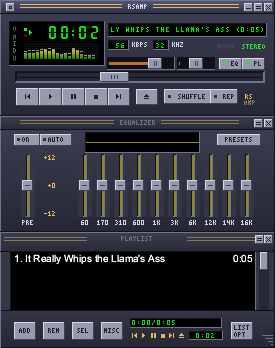

# rsAmp



A classic-style music player vibe coded in Rust, for Windows, Linux and macOS.
It loads `.wsz` [skins](https://skins.webamp.org/) made for Winamp 2.x and draws them pixel for pixel.

**Download [this skin](https://skins.webamp.org/skin/5e4f10275dcb1fb211d4a8b4f1bda236/base-2.91.wsz/)** and drag 
it onto rsAmp to get the look and feel you expect :P

## Features

- **Skins**: `.wsz`/`.zip` files or extracted skin folders, with a built-in skin as fallback.
- **Main window**: transport, seek bar, volume/balance, time display (click for remaining
  time), scrolling title, shuffle/repeat, and a visualizer (click it to cycle: spectrum bars,
  thin "fire" spectrum, oscilloscope, off).
- **Equalizer**: 10 bands plus preamp, ON/AUTO, response graph, presets.
- **Playlist**: multi-select, drag to reorder, resize, ADD/REM/SEL/MISC/LIST menus,
  `.m3u`/`.m3u8`/`.pls` playlists, plus VLC `.xspf` playlists (open only).
- **Window shade**: collapse any window to a short bar (shade button, double-click the title
  bar, or Ctrl+W).
- **Always on top**, **double size**, and **zoom** from 50% to 1000% in 10% steps.
- **Audio**: MP3 (CBR/VBR), FLAC, Ogg Vorbis, WAV, AAC/M4A, with ID3 and Vorbis tags.
- **Drag & drop**: files dropped on the main window play right away, files dropped on the
  playlist are added to it, and a dropped `.wsz` changes the skin.
- Settings, the playlist and window position are remembered between runs.

## Usage

Run it and drag and drop music files or folders onto it (`.mp3`, `.flac`, `.ogg`, `.wav`,
`.m4a`), or playlists (`.m3u`, `.pls`, VLC's `.xspf`).

- **Change skin**: click **O** in the clutter bar (the small strip on the left of the main
  window), or drop a `.wsz` onto the window. On startup rsAmp uses, in order: `--skin`, the last skin used, then
  the first `.wsz` in a `Skins` folder or next to the exe, then the built-in skin.
- **Zoom**: Ctrl + mouse wheel (⌘ on macOS).
- **Move**: drag any title bar or empty space on the main window.
- **Settings file**: `%APPDATA%\rsAmp\config.json` (Windows), `~/.config/rsAmp/config.json`
  (Linux), `~/Library/Application Support/rsAmp/config.json` (macOS).

| Key | Action | Key | Action |
|---|---|---|---|
| Z X C V B | prev / play / pause / stop / next | ← / → | seek −5 s / +5 s |
| L / Ctrl+L | open files / add folder | ↑ / ↓ | volume |
| R / S | repeat / shuffle | Ctrl+A | always on top (in the playlist: select all) |
| Ctrl+D | double size | Ctrl+= / Ctrl+- / Ctrl+0 | zoom in / out / reset |
| Ctrl+W | window shade | Alt+G / Alt+E | toggle EQ / playlist |
| Alt+S | load skin | Enter / Delete | play / remove selection |

**Command line options:**

```
rsAmp [--skin <skin.wsz | skin-folder>] [files | folders | playlists ...]
```

## Building

Requires [Rust](https://rustup.rs).

```
cargo build --release
```

The binary is `target/release/rsAmp` (`rsAmp.exe` on Windows). It is a single file that needs
no extra libraries at runtime.

- **Windows / macOS**: no extra dependencies.
- **Linux**: install ALSA headers and pkg-config (`sudo apt install libasound2-dev pkg-config`
  or `sudo dnf install alsa-lib-devel pkgconf`).
- **Windows exe from Linux**: install mingw-w64, then
  `rustup target add x86_64-pc-windows-gnu` and
  `cargo build --release --target x86_64-pc-windows-gnu`.

Run the tests with `cargo test`.

## Trademarks

rsAmp is an independent project, not affiliated with or endorsed by the owners of Winamp,
which is a trademark of its respective owner and is named here only to describe skin
compatibility. rsAmp contains no Winamp code or artwork.
